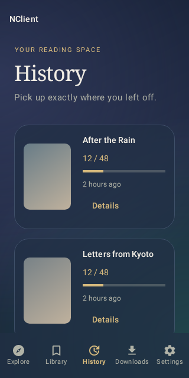

# History details — build 420709 / 4.2.7-debug9

History cards now have a visible **Details** button. It opens the gallery page
with the artist and tag section expanded. Tapping the rest of the card still
resumes reading at the saved page.

The reader menu also has **About this gallery**. Tap the page to reveal the
toolbar, then open its overflow menu. This opens gallery details without closing
the reader; Back returns to the same reading position.

Both routes reuse the saved gallery metadata, including artist tags. Older
history entries without a metadata snapshot still need one API request. Downloaded
galleries use their local metadata when available. Existing reading progress,
image caching, themes and accent colors remain unchanged.

This update does not integrate another content provider. Automated regression
checks cover both navigation routes, artist metadata restoration, saved progress,
and existing history/cache/theme behavior. Android rendering tests include the
new button on normal and small screens. No physical-device test is claimed.

Both variants build and pass 92 tests each (184 total, none skipped). Lint reports
zero errors and 80 warnings. APK signatures match build 420708; install this as
an update to NClientV3 Debug to retain app data.

