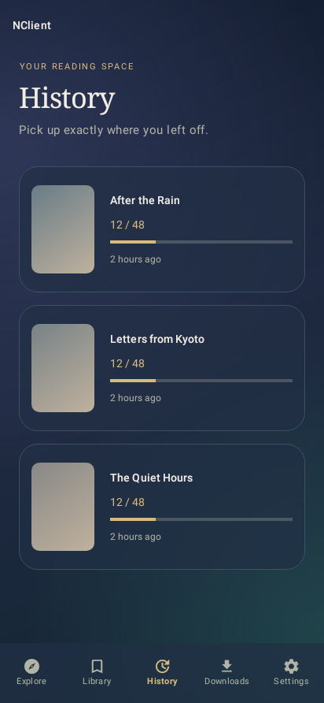
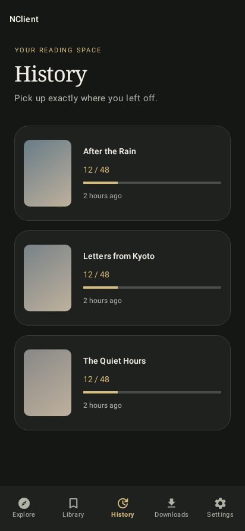
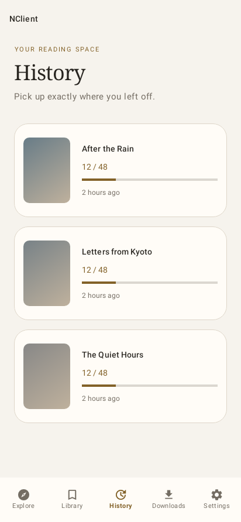

# Reading update — build 420708 / 4.2.7-debug8

## Continue reading

Open **History** in the bottom navigation to see stories you have read, their
saved page, progress bar, and last-read time. Tap a card to open the reader at
that page. Progress saves automatically when pages change, when the reader leaves
the foreground, and when Android recreates it. The gallery's existing Resume
button also uses the automatically saved position.

Online stories keep a local copy of their metadata and exact API image paths.
Opening them from History does not require another gallery-metadata request.
Downloaded stories keep a reference to their existing folder. Moving or deleting
that folder makes its history entry unavailable; history never duplicates the
download. Older history entries remain accessible and fetch metadata on first use.

Long-press a card to remove it, or use the toolbar's clear action to clear history.
Neither action deletes downloaded galleries. **Settings → History size** controls
the new reading-history limit, up to 200 stories; existing size preferences are
honored and new installations default to 100. Merely opening gallery details no
longer adds unread stories to history.

## Image caching

- A dedicated Glide cache stores up to **512 MiB of original image bytes**, with
  automatic removal of least-recently-used entries. Thumbnails and reader pages
  use the same cache policy; resized or rotated views can reuse the saved source.
  It reuses Glide's existing cache directory to retain compatible cached images
  from the previous build.
- Previously cached images can load offline, including when image downloading is
  disabled in data-usage settings. An image still needs a connection on its first
  load or after eviction. Android can reclaim cache storage; use Downloads for
  permanent offline copies.
- Decoded bitmap caches and pools have memory limits. The reader decodes at a
  bounded resolution, preloads only nearby pages, and releases distant images.
  Full source bytes remain in the disk cache.
- **Settings → Clear cache** displays current image-cache usage and clears it
  through Glide's synchronized API. Downloaded files and reading history remain.
  The dedicated cache is separate from Android's other temporary app storage.

## Appearance

**Settings → Theme** offers **Warm, Midnight, Forest, Amethyst, Paper, OLED Black,
and Glass**. Every theme retains the six independent accent choices: Gold, Jade,
Ocean, Amethyst, Rose, and Copper. Themes apply to navigation, cards, settings,
dialogs, gallery details, and reader controls.

Glass uses translucent surfaces, fine outlines, and a soft gradient backdrop.
It does not require live background blur or Android 12-only rendering features.
History uses spacious vertical cards, with cover and progress information in
separate columns.

The previews below render the production Android layouts with fictional titles
and gradient cover fixtures; they are not captures of live gallery content.

| Glass | Warm | Paper |
| --- | --- | --- |
|  |  |  |

## Verification

Both APK variants build and pass **90 tests each (180 total, none skipped)**.
Android lint reports **0 errors and 80 warnings**.

Automated checks cover database restart and independent reading positions,
metadata/path round-tripping, bounded history, local downloads, reader recreation,
opening History directly at the saved page, legacy history, theme selection,
accent contrast, and layouts on Android 12 at normal and small screen widths.
A local HTTP server verifies real Glide image decoding, offline reuse at a new
size after clearing memory, and cache removal without deleting a saved file.

Both APK variants use the same application ID and signing certificate as build
420707 and can update **NClientV3 Debug** without uninstalling it. The APKs and
checksums are in [apks](../apks/README.md). Tests use Robolectric and controlled
responses; no physical-device or live-site test is claimed for this update.
